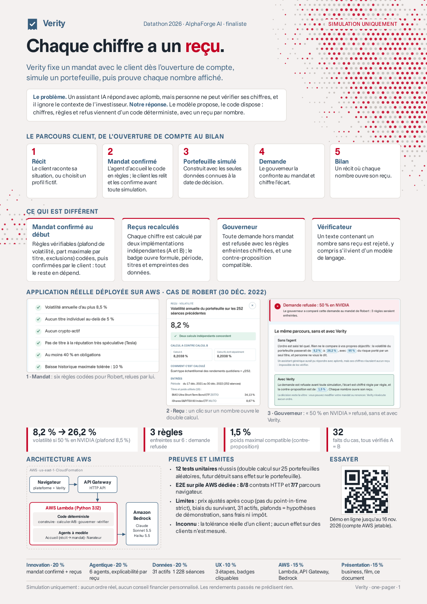

<div align="center">

# Verity — Équipe 56

### Chaque chiffre a un reçu.

Un système agentique **explicable** pour investisseurs particuliers — Datathon Polyfinances 2026 (AlphaForge AI)

**Équipe 56 — Auteur : Emilien Bel**

[▶ Film de démo (4 min 15)](https://youtu.be/Uri8o8oOOuk) ·
[One-pager (PDF)](https://drive.google.com/file/d/1TKNiokm5OwzrVCkVMTxUVQiKKLvJaFXF/view) ·
[Note technique (PDF)](https://drive.google.com/file/d/1qZj2TivpXK23FP7a9IDoS50a0LwvFuGT/view)

</div>

> **Simulation uniquement : aucun ordre réel, aucun conseil financier personnalisé.** Les rendements passés ne prédisent rien.

## Livrables

| Livrable | Lien |
|---|---|
| Film de démo (≈ 4 min 15, voix ElevenLabs) | [YouTube](https://youtu.be/Uri8o8oOOuk) · [sous-titres .srt](https://drive.google.com/file/d/1_gyL3hvewqKroIw11GfMsLQqdNestPXU/view) |
| One-pager (1 page A4) | [PDF](https://drive.google.com/file/d/1TKNiokm5OwzrVCkVMTxUVQiKKLvJaFXF/view) · [Google Doc éditable](https://docs.google.com/document/d/1yiWcIxgyzVOhq3kBjqcfldIoVyBsJhhN8BhUrm28weI/edit) · copie dans le dépôt : [`docs/Verity_one_pager.pdf`](docs/Verity_one_pager.pdf) |
| Documentation technique (4 pages) | [PDF](https://drive.google.com/file/d/1qZj2TivpXK23FP7a9IDoS50a0LwvFuGT/view) · [Google Doc éditable](https://docs.google.com/document/d/1sU1xX3M1y6JlHU7oMLFuP7hdIyCaE2J9kLyjPHOlRv0/edit) · copie dans le dépôt : [`docs/Verity_documentation_technique.pdf`](docs/Verity_documentation_technique.pdf) |
| Application (AWS, us-east-1) | `https://13hgyrsu38.execute-api.us-east-1.amazonaws.com/` — compte jetable de l'événement, **peut ne plus être en ligne** (destruction AWS le 16 novembre 2026) |



## Le problème

Un investisseur particulier reçoit des chiffres (risque, rendement, volatilité) qu'il ne peut ni vérifier ni relier à sa situation. Verity part du récit du client, le transforme en règles vérifiables, puis refuse d'afficher tout nombre dont il ne peut pas montrer le calcul.

Verity se place **à l'ouverture de compte** dans le parcours d'un courtier :
*récit du client → mandat codé → portefeuille simulé → demandes → bilan*. Chaque nombre affiché est un badge qui ouvre son **reçu** (formule, période, titres, double calcul, empreinte des données) ; un **vérificateur** refuse tout texte contenant un nombre sans reçu.

## Dans la plateforme du courtier

`/` sert un mockup de plateforme de courtage (fixtures, ressources réutilisées du ticket BOILERROOM-11, direction artistique Banque nationale). L'entrée **« Ouvrir un compte · Mon mandat »** ouvre Verity dans un panneau plein écran ; **« Retour à la plateforme »** ou Échap ramène à la même vue (la page hôte n'est jamais rechargée). `/?entry=mandat` ouvre directement le panneau ; l'application autonome reste sur `/verity/`. Code : `web/broker.html`, `web/js/broker-entry.js`, `web/css/broker-entry.css` (hôte) ; scénarios E2E 8-13 dans `e2e/README.md`.

## Les agents

| Agent | Rôle | Nature |
|---|---|---|
| Accueil | récit libre → mandat JSON (règles vérifiables), validé par un schéma strict | Claude Sonnet 5.5 (Amazon Bedrock) |
| Constructeur | portefeuille sous mandat, **données ≤ date de décision uniquement** | code déterministe |
| Analyste | chaque fait est calculé **deux fois** par deux implémentations indépendantes (A/B) | code déterministe |
| Narrateur | explication en phrases claires, uniquement avec des jetons de faits | Claude Haiku 5.5, repli sur gabarit |
| Vérificateur | rejette tout chiffre libre, fait inconnu/non vérifié, date hors calendrier | code déterministe |
| Gouverneur | confronte une demande au mandat, chiffre la tension, propose le plus grand poids compatible | code déterministe |

Principe : **le modèle propose, le code dispose** — les modèles ne produisent jamais de chiffres.

## Données

Jeu de départ AlphaForge AI (`data/`) : 31 actifs, prix quotidiens ajustés (Yahoo Finance), USD/CAD (Banque du Canada), du 2021-11-12 au 2026-11-12 ; `sources_metadata.csv` documente source, date, traitement et limites. Calendrier commun = intersection des dates observées (1 228 séances) ; titres USD convertis au dernier taux connu ; calculs en CAD. Les CSV du jeu de départ sont conservés pour la reproduction, fournis par les organisateurs du datathon ; ils restent soumis aux conditions de leurs fournisseurs (Yahoo Finance, Banque du Canada).

## Reproduire

Python 3.12, aucune dépendance pour le moteur (`boto3` seulement pour les agents Bedrock et la voix).

```bash
python -m unittest discover -s tests -v          # 12 tests : calculs, double implémentation, pas de regard vers le futur, mandats, vérificateur
PORT=8080 python app.py                          # développement local (nécessite des identifiants AWS pour /api/narrate et /api/compile)
python scripts/deploy.py                         # déploiement AWS (voir docs/deploy.md)
E2E_URL=https://<api>/ python -m unittest e2e.test_api -v   # bout en bout contre la pile AWS
python scripts/build_docs.py --pdf               # documentation technique et one-pager (tous les chiffres viennent du moteur)
```

Tests : `E2E_URL=<url> python3 e2e/test_broker_entry.py` (plateforme) et `UI_URL=<url> python3 e2e/ui_smoke.py` (application).

API : `GET /api/personas`, `GET /api/assets`, `POST /api/analyze`, `POST /api/narrate`, `POST /api/compile`, `POST /api/verify`.

## Méthode et limites

Poches (actions, FNB actions, obligations, or, crypto) ; un curseur de croissance mélange un profil défensif et un profil croissance ; pondération par l'inverse de la volatilité (252 séances **avant** la décision), plafonnée ; on retient le curseur le plus élevé respectant **toutes** les règles. Aucune prévision de rendement. Portefeuille acheté à la date de décision puis conservé (sans frais, impôt, rééquilibrage). Les plafonds des mandats sont des hypothèses de démonstration. Prix ajustés rétrospectivement (pas du point-in-time strict) ; biais du survivant ; 31 actifs seulement ; pas de données ESG ni fondamentales (l'exclusion « Énergie » est un substitut simple). Les rendements passés ne prédisent rien.

## Déploiement

Entièrement sur AWS (us-east-1) : Lambda Python 3.12 + API Gateway HTTP API, Amazon Bedrock, Amazon Polly pour la voix de la vidéo, CloudFormation (`infra/`). Compte jetable de l'événement : expire le 16 novembre 2026.
